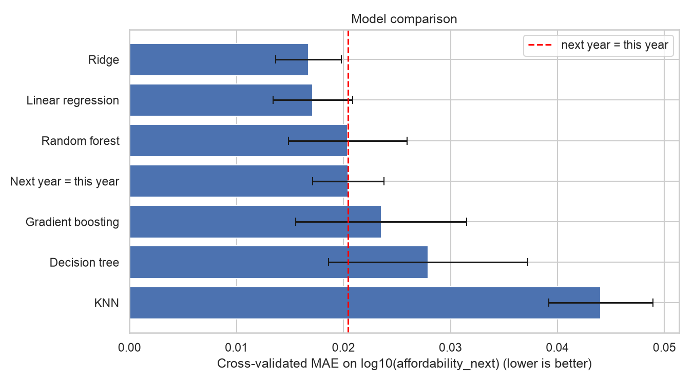
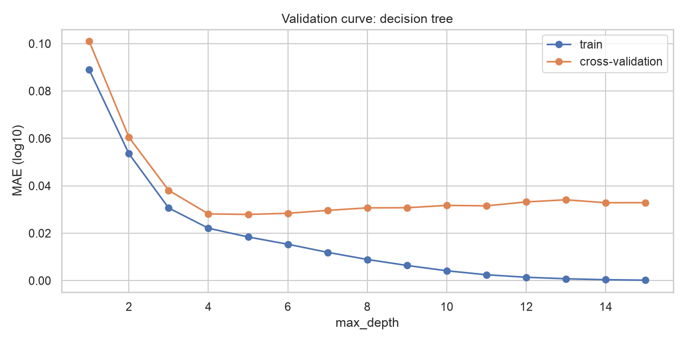
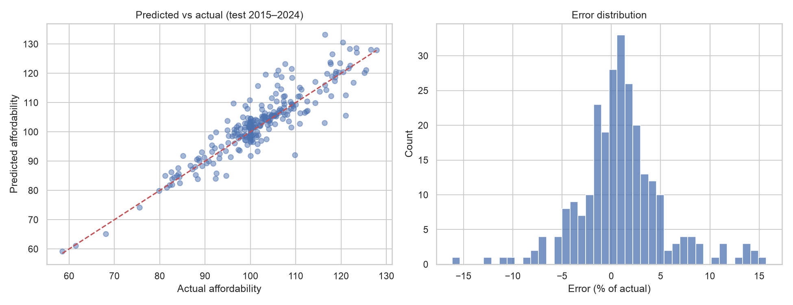
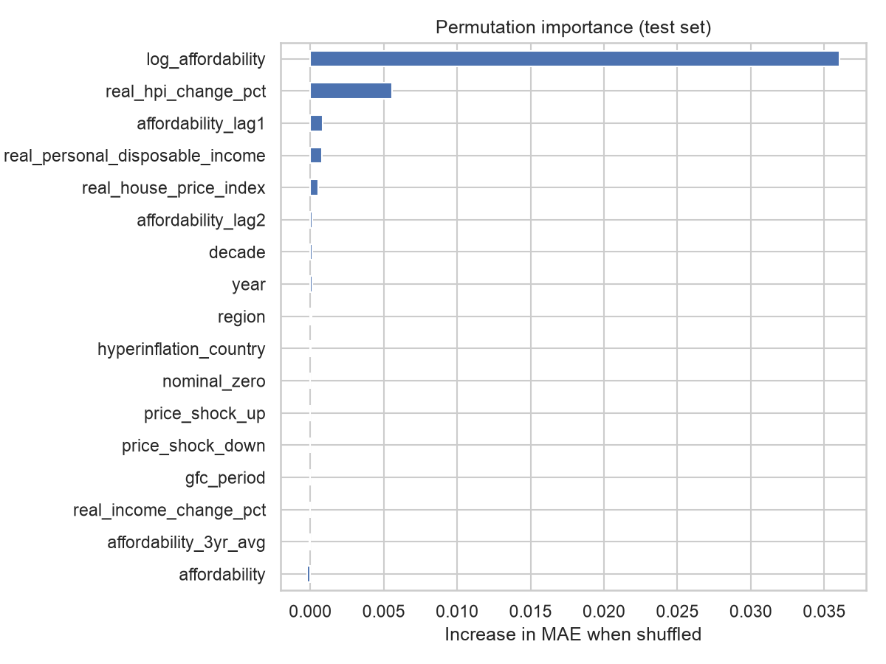
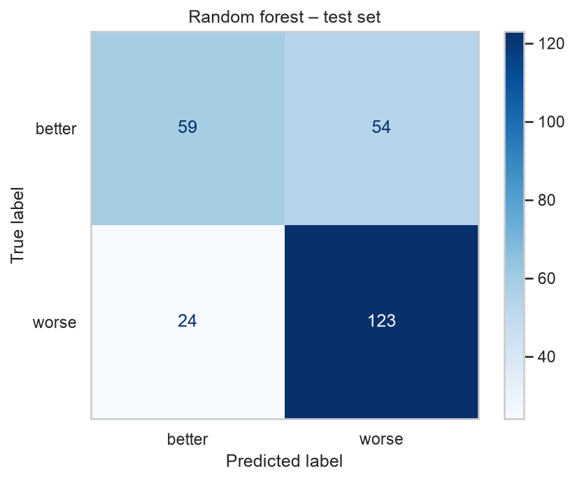

# Day 2 explained: what we did, how we coded it, and what we learned

This file walks through `notebook/Day2_models.ipynb` step by step: **what** each part does, **how** the code works, and **what the results and graphs taught us**. Read it next to the notebook.

---

## The question

> Can we predict **next year's housing affordability** in a country from what we know **this year**?

- **Data:** `data/housing_affordability_model_ready.csv`, the output of Day 1. One row = one country in one year (26 countries, 1977–2024, 1,210 rows).
- **Target:** `affordability_next`, next year's affordability. It is a ratio of house prices to income, as an index: **higher = less affordable**.
- **Who would use it:** a housing policy analyst who wants an early warning before the official statistics come out.
- **Which mistake is worse:** missing a big deterioration (predicting "stable" when it gets much worse). Big errors matter, so we look at errors in percent and at the worst countries.

---

## 0. Setup

```python
df = pd.read_csv(ROOT / "data" / "housing_affordability_model_ready.csv")
df = df.sort_values(["year", "iso"]).reset_index(drop=True)
```

We sort the rows **by year**. Everything later (the split and the cross-validation) depends on the rows being in time order.

`ROOT` is `.` or `..`, depending on whether the notebook runs from the repo root or from `notebook/`, so the paths work either way.

---

## 1. Core concepts

### 1.1 Train / test split, target and inputs

```python
X = df.drop(columns=["affordability_next", "iso", "data_reliable", "is_latest_year"] + region_cols)
X["log_affordability"] = np.log10(df["affordability"])
X["region"] = df[region_cols].idxmax(axis=1).str.replace("region_", "")
X["decade"] = df["decade"].astype(str) + "s"
y = np.log10(df["affordability_next"])

is_train = df["year"] < 2015
```

**What we did and why:**

| Decision | Why |
|---|---|
| **Split by year:** train 1977–2014 (950 rows), test 2015–2024 (260 rows) | Neighbouring years of a country are almost identical. A random split would let the model train on 2014 and 2016 and "predict" 2015, which means seeing the future. In real use we always predict a year we have not seen. |
| **Target = log10(affordability_next)** | The target is very skewed (most values ≈ 100, a few above 600). On a log scale it looks much more like a bell curve, which models handle better. A prediction is turned back with `10 ** prediction`. |
| **Removed `affordability_next`** | It is the answer itself. |
| **Removed `iso`** | It is a name tag, not a measurement. |
| **Removed `data_reliable`, `is_latest_year`** | Same value in every row of this file, so they carry no information. |
| **Added `log_affordability`** | This year's value on the same log scale as the target. It is known at prediction time, so it is allowed. |
| **Rebuilt `region` and `decade` as text** | Day 1 had already encoded them. We undo that, so section 2 can show how to encode them properly inside a pipeline. |

**From the histogram:** `affordability_next` has a long tail to the right (the extreme values are South Korea around 1978–83). After log10 the distribution is compact and much less skewed.

### 1.2 Underfitting and overfitting

We made up a small example: energy demand of a façade as a U-shaped function of the window-to-wall ratio, plus random noise. Then we fitted curves of increasing complexity (polynomial degree 1, 2 and 15):

```python
poly = Pipeline([("poly", PolynomialFeatures(degree)), ("scale", StandardScaler()), ("lr", LinearRegression())])
```

| Degree | Train error | Test error | Diagnosis |
|---|---|---|---|
| 1 (straight line) | 21.0 | 24.3 | **Underfitting:** too simple, both errors high |
| 2 | 5.3 | 6.5 | **Good fit:** follows the true curve |
| 15 | 5.0 | 9.5 | **Overfitting:** lowest training error, but the test error almost doubles |

**What it taught us:** a low **training** error proves nothing. The model must be judged on data it has not seen. The degree-15 curve bends to follow the noise and shoots up at the edge where there are few points.

### 1.3 Cross-validation

We must not use the test set to choose between models: then it would no longer be "unseen". Instead we split the **training set** into 5 folds, train on some, validate on the rest, repeat, and average.

```python
tscv = TimeSeriesSplit(n_splits=5)
kfold = KFold(n_splits=5, shuffle=True, random_state=SEED)
time_scores = -cross_val_score(tree, X_num, y_train, cv=tscv, scoring="neg_mean_absolute_error")
```

- `TimeSeriesSplit` always trains on **earlier** rows and validates on **later** rows, which is how forecasting works in reality.
- scikit-learn returns errors as **negative** numbers ("bigger is better"), so we put a minus in front.

**Result (decision tree):**

| Folds | MAE |
|---|---|
| Time-based | 0.0260 ± 0.0062 |
| Shuffled `KFold` | 0.0227 ± 0.0012 |

**What it taught us:** shuffled folds make the model look **≈ 13% better** than it really is, because it gets to see the years around the one it predicts. For time data, the folds must respect time.

### 1.4 Baselines

Before trusting any score, ask: *what would a "dumb" rule get?*

```python
mean_scores = -cross_val_score(DummyRegressor(), X_num, y_train, cv=tscv, scoring="neg_mean_absolute_error")
persistence_scores = [mean_absolute_error(y_train.iloc[val], X_train["log_affordability"].iloc[val])
                      for _, val in tscv.split(X_train)]
```

| Model | CV MAE (log10) |
|---|---|
| Mean baseline (always the average) | 0.1201 |
| **"Next year = this year"** | **0.0204** |
| Decision tree | 0.0260 |

**How to read an MAE on log10:** an error of 0.02 means a factor of 10^0.02 = 1.047, so **about ±4.7%**.

**What it taught us:** the tree easily beats the mean, but it **loses** to simply copying this year's value. Affordability changes slowly, so "next year = this year" is the real bar every model has to clear.

### 1.5 Data leakage

Leakage means a model uses information it would not have at prediction time. We tested it on purpose by adding **next year's growth**, which is calculated from the answer:

```python
X_leaky = X_num.assign(log_growth_next=np.log10(df.loc[is_train, "affordability_next"] / df.loc[is_train, "affordability"]))
```

| Inputs | CV R² |
|---|---|
| Honest | 0.973 |
| With the leak | **1.000** |

**What it taught us:** a perfect score is a **red flag**. The model just adds `log10(this year) + log10(growth)` and needs to learn nothing. The quiet version of leakage is fitting a scaler or imputer on all the data before splitting, which pipelines prevent (section 2).

---

## 2. Preprocessing pipeline

```python
preprocess = ColumnTransformer([
    ("num", Pipeline([("impute", SimpleImputer(strategy="median")), ("scale", StandardScaler())]), numeric_cols),
    ("region", Pipeline([("impute", SimpleImputer(strategy="most_frequent")),
                         ("onehot", OneHotEncoder(handle_unknown="ignore"))]), ["region"]),
    ("decade", OrdinalEncoder(categories=[decade_order], handle_unknown="use_encoded_value", unknown_value=-1), ["decade"]),
])
pipe = Pipeline([("prep", preprocess), ("model", Ridge())])
```

**How it works:**
- A **`ColumnTransformer`** sends each group of columns to its own preparation and glues the results back together.
- A **`Pipeline`** chains that preparation with the model into **one object** with one `fit` and one `predict`.
- When a pipeline goes into `cross_val_score`, the imputer, scaler and encoders are **refitted inside each fold** on that fold's training rows only, so there is no leakage.

| Columns | Steps | Why |
|---|---|---|
| 15 numeric | median imputer → `StandardScaler` | Fills any gaps; puts all columns on the same scale (mean 0, std 1), which linear models and KNN need |
| `region` (nominal: no order) | most-frequent imputer → **one-hot** | One 0/1 column per region. No fake order is invented. `handle_unknown="ignore"` avoids a crash on a new category |
| `decade` (ordinal: real order) | **ordinal** encoder with the order written out | 1970s = 0 … 2020s = 5. Without the list, scikit-learn would use alphabetical order |

Result: **17 input columns → 26** after preprocessing (region becomes 10 columns).

**Encoders we did not use:**
- **Label / ordinal encoding of `region`** would claim that "Western Europe (9)" is more than "Asia (1)", which is nonsense for a linear model.
- **Target encoding** is useful with hundreds of categories; with 10 regions, one-hot is simpler and safe.
- **`country`** is left out: one column per country would let the model memorise each country's index level. Those levels are not comparable between countries, because every index has its own base year.

---

## 3. Model comparison

```python
for name, model in models.items():
    pipe = Pipeline([("prep", preprocess), ("model", model)])
    scores = -cross_val_score(pipe, X_train, y_train, cv=tscv, scoring="neg_mean_absolute_error")
```

Every model gets the **same** preprocessing, the **same** 5 time-based folds and the **same** metric.

| Model | CV MAE (log10) | ± std | ≈ typical error |
|---|---|---|---|
| **Ridge** | **0.0167** | 0.0031 | **3.9%** |
| Linear regression | 0.0171 | 0.0037 | 4.0% |
| Random forest | 0.0204 | 0.0055 | 4.8% |
| Next year = this year | 0.0204 | 0.0033 | 4.8% |
| Gradient boosting | 0.0235 | 0.0080 | 5.6% |
| Decision tree | 0.0279 | 0.0093 | 6.6% |
| KNN | 0.0441 | 0.0049 | 10.7% |
| Mean baseline | 0.1201 | 0.0361 | 31.9% |



**What the graph taught us:**
- Only the **linear models** end up clearly left of the red line ("next year = this year").
- The **tree-based models** (forest, boosting, tree) tie with it or do worse. A tree can only predict values it saw in training (each leaf is an average of training rows), but affordability keeps drifting to new levels. A linear model can say "this year's value plus a bit", which is exactly the shape of this problem.
- **KNN** is worst: comparing country-years by distance across 26 columns does not work well here.
- The error bars (± std) show the noise. Differences smaller than about 0.003–0.008 are not meaningful.
- **Lesson:** the "best model for tables" (gradient boosting) is not automatically the best. The model must fit the structure of the problem.

---

## 4. Diagnosis and tuning

### 4.1 Validation curve: how deep should a tree be?

```python
for d in depths:
    pipe = Pipeline([("prep", preprocess), ("model", DecisionTreeRegressor(max_depth=d, random_state=SEED))])
    cv_mae.append(-cross_val_score(pipe, X_train, y_train, cv=tscv, scoring="neg_mean_absolute_error").mean())
    pipe.fit(X_train, y_train)
    train_mae.append(mean_absolute_error(y_train, pipe.predict(X_train)))
```



**What the graph taught us:**
- **Depth 1–3:** both errors are high, so the tree **underfits**.
- **Best depth ≈ 5** (CV MAE ≈ 0.028).
- **Deeper:** the training error falls towards 0 (the tree memorises the training years), while the CV error stays flat and creeps up, so it **overfits**. The growing gap between the two lines measures the overfitting.
- Even the best tree does not beat "next year = this year" (0.020). This confirms section 3.

### 4.2 Grid search: tuning Ridge

```python
grid_search = GridSearchCV(ridge_pipe, {"model__alpha": [0.01, 0.1, 1, 10, 100]},
                           cv=tscv, scoring="neg_mean_absolute_error")
```

`alpha` controls how strongly Ridge keeps its weights small (regularisation). The name `model__alpha` means "the `alpha` of the step called `model`" in the pipeline.

| alpha | 0.01 | 0.1 | **1** | 10 | 100 |
|---|---|---|---|---|---|
| CV MAE | 0.0171 | 0.0170 | **0.0167** | 0.0201 | 0.0288 |

**What it taught us:** small values all give about the same score, and strong penalties hurt. The best is `alpha = 1`, the default, so tuning brought no real gain. Good features and the right model family mattered much more than tuning.

**Final model: Ridge with alpha = 1.** It is the most accurate, the fastest (milliseconds) and the easiest to explain.

---

## 5. Final test (used once)

```python
final_model = grid_search.best_estimator_
y_pred = final_model.predict(X_test)
actual, predicted = 10 ** y_test, 10 ** y_pred
```

`GridSearchCV` has already refit the best model on the whole training set. Only now do we touch the test years, 2015–2024.

| Metric (test 2015–2024) | Ridge | Next year = this year |
|---|---|---|
| MAE | **3.28** index points | 3.74 |
| RMSE | **4.75** index points | 5.26 |
| R² (log scale) | 0.83 | |
| Within ±5% | **83%** of country-years | |



**What the graphs taught us:**
- **Predicted vs actual:** the points lie close to the red diagonal, which is where a perfect prediction would be.
- **Error distribution:** centred near 0 (the average error is +1%, so the model is very slightly too pessimistic), with a few misses of 10–15%.
- **The test error is lower than the CV error.** This is not a mistake: 2015–2024 was calmer than the cross-validation years, which include the 1980s–90s and the 2008 crisis.

| Easiest countries (median error) | Hardest countries |
|---|---|
| Spain 0.8%, Belgium 0.9%, France 1.0% | Japan 4.1%, Sweden 4.1%, Canada 4.8% |

The hardest countries had **sharp turns** in affordability. The model has no data on interest rates, supply or migration, so it cannot see such turns coming.

---

## 6. Interpretation: what does the model rely on?

**Ridge coefficients:** the weight of each scaled input.

```python
coefs = pd.Series(final_model.named_steps["model"].coef_,
                  index=final_model.named_steps["prep"].get_feature_names_out())
```

- `log_affordability` ≈ **0.17**, by far the biggest: next year ≈ this year.
- `real_hpi_change_pct` ≈ **0.016**, the main correction: when real house prices grew fast this year, affordability tends to get worse again next year (**momentum**).
- `affordability_lag1` is **negative** (−0.013). This does **not** mean that last year's level lowers next year's: the affordability columns (level, log, lag 1, lag 2, 3-year average) carry almost the same information, so the model splits their effect in odd ways. Correlated features have to be read **together**.

**Permutation importance:** shuffle one column on the test set and measure how much the error grows.



| Feature | Increase in MAE when shuffled |
|---|---|
| `log_affordability` | 0.036 |
| `real_hpi_change_pct` | 0.006 |
| `affordability_lag1` | 0.001 |
| everything else | ≈ 0 |

**What it taught us:** the model is essentially *"this year's affordability + momentum from price growth"*. Region, decade and the Day 1 flags add almost nothing. Importance shows what the **model** uses, not what **causes** affordability.

---

## 7. Save and reuse the model

```python
joblib.dump(final_model, MODEL_DIR / "model.joblib")
loaded = joblib.load(MODEL_DIR / "model.joblib")
```

The saved pipeline contains **everything**: medians, categories, scaling and the Ridge weights. You can give it a raw row with the same columns and get a forecast.

**Example: Spain**
- With its 2024 values, affordability is 100.0 in 2024 and the forecast for 2025 is **101.5**: slightly worse.
- What if real house prices had risen 10% more in 2024? The forecast becomes **116.9**, about **+15%**. That is more than the 10% shock itself, because the model adds momentum.

`models/model.joblib` is **not** committed to GitHub (`.gitignore`); it is meant for Hugging Face.

---

## 8. Classification: will affordability get worse next year?

Same inputs, a yes/no target:

```python
y_class = np.where(df["affordability_next"] > df["affordability"], "worse", "better")
```

The training years are about balanced: 49% "worse", 51% "better".

| Model | CV macro F1 |
|---|---|
| Baseline (most frequent) | 0.334 ± 0.039 |
| Logistic regression | 0.677 ± 0.047 |
| Decision tree | 0.669 ± 0.067 |
| **Random forest** | **0.704 ± 0.028** |

**Macro F1** balances precision (when the model says "worse", is it right?) and recall (of all real "worse" years, how many did it find?), averaged over both classes.

**Test set (2015–2024), random forest:**



| | predicted better | predicted worse |
|---|---|---|
| **actually better** (113) | 59 | 54 |
| **actually worse** (147) | 24 | **123** |

**What it taught us:**
- It finds **123 of the 147** real deteriorations (**recall 0.84**). For an early warning, that is the number that matters.
- The price is **54 false alarms**: years it predicted "worse" that actually improved. For this use case, a false alarm is the cheaper mistake.
- Accuracy is 0.70. Predicting the **direction** of a change that is often only 1–2% is much harder than predicting the level, so this is a realistic result.
- Unlike the regression, a **tree ensemble** wins here, not the linear model. Choosing a direction depends on thresholds (e.g. "prices still rising fast *and* affordability not yet extreme"), which trees capture well. There is no single best model; you always have to compare.

---

## Main lessons

1. **Respect time.** Split and cross-validate by year. Shuffling made the model look about 13% better than it is.
2. **Always compare with a baseline**, and for forecasts, the strong one: "next year = this year" (≈ 4.8% error). Several models did not beat it.
3. **A perfect score means leakage.** Next year's growth gave R² = 1.0.
4. **Pipelines** keep all preprocessing inside the cross-validation, and make the model one object you can save.
5. **Choose the model for the problem.** Ridge won the forecast (≈ 3.9% CV error, 3.3 index points on the test set); a random forest won the "worse or better" question.
6. **Next year's affordability = this year's + momentum from house price growth.** The model fails where affordability turned sharply (Japan, Sweden, Canada), because it knows nothing about interest rates or housing supply.

## Limitations

- **Indexes, not money:** levels cannot be compared between countries, only changes over time.
- **Missing drivers:** no interest rates, mortgage rules, supply or migration data.
- **Coverage:** national averages only, and 26 mostly high-income countries.
- **Horizon:** forecasts are one year ahead only.
- **Small data:** 950 training rows, so small differences between models are within noise.
