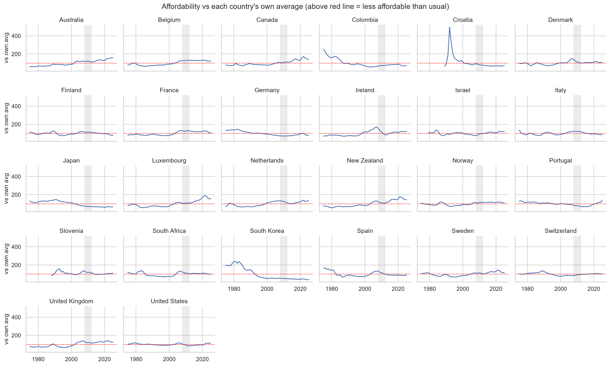
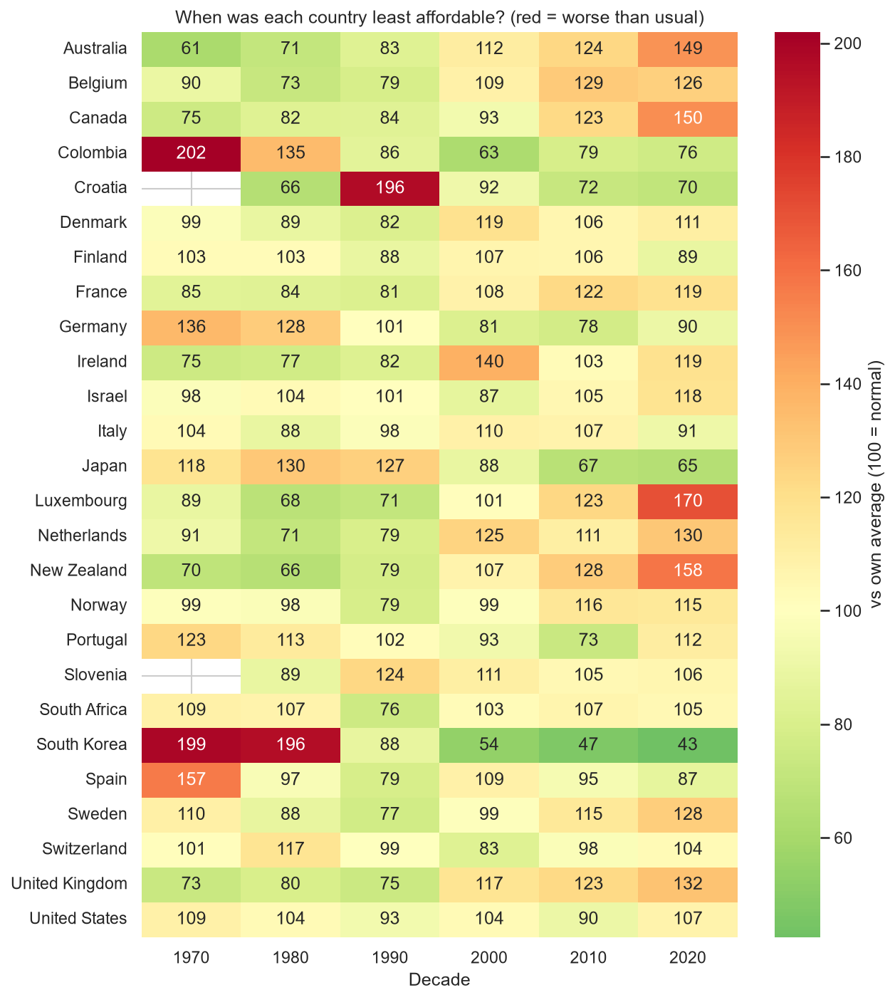

# Group8-day1-assignment
we are 3 students at IAAC 2026-2027, super exciting! 
- Akshat
- Bhavini
- Bo
# Housing Affordability Across 26 Countries (1975–2025)
### Data cleaning, feature engineering and exploratory data analysis

**Group 8:** Akshat Dayal, Bhavini Manot, Bo De Roeck
**Model on Hugging Face (Day 2):** https://huggingface.co/iaac-maai/day2-group8-affordability
**Course:** IAAC · Master in AI for Architecture and Business Innovation (MaAI) 2026–27 · AI Methods · Day 1
**Notebook:** `Notebook_Akshat.ipynb`

---

## Contents
1. [Use case](#1-use-case)
2. [Dataset card](#2-dataset-card)
3. [How to run](#3-how-to-run)
4. [Inspection](#4-inspection)
5. [Cleaning log](#5-cleaning-log)
6. [Feature engineering](#6-feature-engineering)
7. [Exploration and findings](#7-exploration-and-findings)
8. [Data leakage](#8-data-leakage)
9. [Model-ready dataset](#9-model-ready-dataset)
10. [Notes for Day 2](#10-notes-for-day-2)
11. [Repository structure](#11-repository-structure)
12. [AI usage disclosure (Day 2)](#12-ai-usage-disclosure-day-2)

---

## 1. Use case
How has **housing affordability** (house prices relative to household income) changed across 26 countries over the last 50 years, and can **next year's affordability** be predicted?

This notebook prepares the ground: it inspects and cleans the raw data, documents every data problem, engineers features, explores the trends with charts, and saves a **model-ready dataset** for supervised learning on Day 2.

---

## 2. Dataset card

| | |
|---|---|
| **Name** | Housing affordability, 26 countries, 1975–2025 |
| **Source** | Kaggle, [dataset used in this notebook](https://www.kaggle.com/code/tolstoyjustin/forecasting-housing-affordability-to-2035/input) |
| **File** | `accessibilit-economica-alloggi-26-paesi-1975-2025.csv` |
| **Likely original source** | Dallas Fed International House Price Database (column names match; to confirm) |
| **Size** | 1,326 rows × 8 columns |
| **One row** | one country in one year |
| **Coverage** | 26 countries × 51 years, balanced panel, no gaps |

**Countries:** Australia, Belgium, Canada, Colombia, Croatia, Denmark, Finland, France, Germany, Ireland, Israel, Italy, Japan, Luxembourg, Netherlands, New Zealand, Norway, Portugal, Slovenia, South Africa, South Korea, Spain, Sweden, Switzerland, United Kingdom, United States.

| Column | Type | Meaning |
|---|---|---|
| `country` | text | Country name |
| `iso` | text | 3-letter country code |
| `year` | integer | 1975–2025 |
| `house_price_index` | number | House prices as an index (not money) |
| `personal_disposable_income` | number | Household income after tax, as an index |
| `real_house_price_index` | number | House prices adjusted for inflation |
| `real_personal_disposable_income` | number | Income adjusted for inflation |
| `affordability_proxy` | number | price index ÷ income index × 100 (higher = less affordable) |

### Limitations
- **Indexes, not money:** compare trends over time, not price levels between countries.
- **National averages only:** city-level differences (e.g. Barcelona vs the rest of Spain) are hidden.
- **Ignores mortgage interest rates**, which strongly affect real affordability.
- **Hyperinflation** in Israel, Croatia and Slovenia broke the early nominal values (see [Cleaning log](#5-cleaning-log)).
- **Early data may be estimated:** e.g. Croatia has values from 1975, before independence (1991).
- **2025** may be incomplete or estimated.
- **Mostly high-income countries:** results don't represent the whole world.

---

## 3. How to run

1. Clone this repository.
2. Download the CSV from Kaggle and place it in the `data/` folder:
   ```
   data/accessibilit-economica-alloggi-26-paesi-1975-2025.csv
   ```
   Datasets are not committed to the repository (see `.gitignore`).
3. Create an environment and install the packages:
   ```
   python -m venv .venv
   .venv\Scripts\activate          # Windows
   source .venv/bin/activate       # macOS / Linux
   pip install -r requirements.txt
   ```
4. Open `Notebook_Akshat.ipynb`, select the `.venv` kernel and click **Run All**.

**Outputs**
- `figures/`: 7 charts (PNG)
- `data/housing_affordability_clean.csv`: cleaned data with all features
- `data/housing_affordability_model_ready.csv`: dataset for Day 2

**Packages:** pandas, numpy, matplotlib, seaborn (see `requirements.txt`).

---

## 4. Inspection

| Check | Result |
|---|---|
| Shape | 1,326 rows × 8 columns |
| Data types | numbers as float/int, names and codes as text: correct |
| Missing values (`isna`) | **0** in every column |
| Duplicate rows | **0** |
| Duplicate country-year pairs | **0** |
| Years per country | exactly **51** for all 26 countries (balanced panel) |
| Country names / ISO codes | 26 each, consistent spelling |

At first sight the data looks perfect. It isn't, as the next section shows.

---

## 5. Cleaning log

### 5.1 Duplicates
- 0 exact duplicates, 0 duplicate country-year pairs.
- **Action:** none needed.

### 5.2 Missing values: hidden zeros
- `isna()` reports 0 missing values, **but** there are **31 zeros** in `house_price_index` and **30** in `personal_disposable_income`. A price or income index cannot be zero.
- The real (inflation-adjusted) columns contain **no zeros**.
- **Affected:** early years of **Israel, Croatia and Slovenia**.
- **Cause:** hyperinflation (Israel in the 1980s; Yugoslavia in the late 1980s–early 1990s) made early nominal values tiny. Rounding to 2 decimals turned them into `0.00`.
- **Action:** affordability was rebuilt from the real columns; the broken nominal columns were dropped.

### 5.3 Data types
- All types correct.
- **Action:** text trimmed, ISO codes upper-cased, `country` converted to category, abbreviated names written in full ("S. Africa" → "South Africa", "S. Korea" → "South Korea", "UK" → "United Kingdom", "US" → "United States").

### 5.4 Outliers
- **38** country-years had nominal price jumps above 30% per year.
- Most were **fake**, caused by the rounding zeros: `inf`, +1,160% and +1,500% for Croatia and Slovenia, and Croatia's affordability proxy above 700.
- Some are **real** housing booms: Canada 1981, Italy 1981, Netherlands 1976–77, Ireland 1998.
- South Korea's high early values are **real**: incomes grew far faster than house prices.
- **Action:** yearly changes were recalculated with real prices. Changes beyond ±30% are **flagged, not removed**, because removing a year in a time series breaks the lag features and some jumps are genuine.

### 5.5 Found through the charts: Croatia and Slovenia
- Figure 2 still showed a **~500% spike for Croatia** in the early 1990s: the hyperinflation distortion continued after the zeros ended.
- **Action:** Croatia and Slovenia **before 1995** were marked unreliable (`data_reliable = 0`) and excluded from the charts and the model-ready file. In total, **44 rows** are marked unreliable.

### 5.6 Before / after

| | Raw | Clean | Model-ready |
|---|---|---|---|
| Rows | 1,326 | 1,326 | 1,210 |
| Columns | 8 | 23 | 29 |
| Average % missing | 0.0 | 0.68* | 0.0 |
| Impossible values | 31 | 0 | 0 |

\* Missing by design: 26 values (one per country) for lag 1, the yearly changes and the target; 52 (two per country) for lag 2 and the 3-year average.

---

## 6. Feature engineering

The dataset has **no free-text columns** (no listing titles to extract information from), so the hidden information sits in the **country codes**, in **how values change over time**, and in the **problems found during cleaning**.

### 6.1 Region from the country code (text → category)
The ISO code was mapped to a `region`: Southern Europe, Western Europe, Nordic, Central/Eastern Europe, North America, Latin America, Asia, Middle East, Africa, Oceania. Countries in the same region often share housing systems and economic cycles.

### 6.2 Relative position in each country's history
Because the values are indexes, 150 can be normal in one country and extreme in another. Like a floor ratio (the 5th floor of a 5-storey building vs a 30-storey tower), each year is compared to its own country:

| Feature | Meaning |
|---|---|
| `affordability_vs_own_avg` | 100 = normal for that country; 130 = 30% less affordable than usual |
| `affordability_position` | 0 = the country's most affordable year, 1 = its least affordable |

⚠️ Both use the country's full history: exploration only (see [Data leakage](#8-data-leakage)).

### 6.3 Change over time
| Feature | Meaning |
|---|---|
| `decade` | 1970, 1980, … 2020 |
| `real_hpi_change_pct` | yearly change in real house prices (%) |
| `real_income_change_pct` | yearly change in real income (%) |
| `affordability_lag1` | affordability last year |
| `affordability_lag2` | affordability two years ago |
| `affordability_3yr_avg` | 3-year rolling average (smoothed trend) |
| **`affordability_next`** | **target:** next year's affordability |

### 6.4 Flags from the cleaning log
Each data problem became a feature, so a model can account for it instead of ignoring it.

| Cleaning log finding | Feature | Result |
|---|---|---|
| Hidden zeros (hyperinflation + rounding) | `nominal_zero` | 31 rows |
| Countries affected | `hyperinflation_country` | Croatia, Israel, Slovenia |
| Unreliable early years | `data_reliable` | Israel from 1979; Croatia and Slovenia from 1995; 44 rows unreliable |
| Real price jumps above +30% | `price_shock_up` | 4 booms |
| Real price drops below −30% | `price_shock_down` | 1 crash |
| 2008 financial crisis | `gfc_period` | 2008–2012 |
| 2025 may be incomplete | `is_latest_year` | 2025 |

### 6.5 Detective work: what is `affordability_proxy`?
- **Hypothesis:** `affordability_proxy` = house price index ÷ income index × 100.
- **Test:** our calculation ÷ the original column should be ≈ 1.

| Comparison | Median ratio | Rows within 1% |
|---|---|---|
| Nominal columns ÷ proxy | **1.000** | — |
| Real columns ÷ proxy | **1.000** | **100%** |

- **Conclusion:** the proxy is price ÷ income, and the real columns give the same ratio, because prices and incomes are adjusted with the same inflation, which cancels out. So for the rows where rounding produced zeros, affordability was **calculated exactly, not guessed**.
- Rows with impossible affordability (≤ 0) after the fix: **0**.

---

## 7. Exploration and findings

All charts use reliable years only (hyperinflation periods excluded).

| Figure | Question |
|---|---|
| `01_affordability_over_time.png` | How has affordability changed in selected countries? |
| `02_all_countries_vs_own_avg.png` | How does every country compare to its own normal? |
| `03_affordability_by_region.png` | Which regions are least affordable? |
| `04_heatmap_country_decade.png` | When was each country least affordable? |
| `05_prices_vs_income.png` | Do house prices grow faster than incomes? |
| `06_price_change_distribution.png` | How large are yearly price changes? |
| `07_correlations.png` | Which features relate most to next year's affordability? |



### Findings
1. **Rising unaffordability since 2000:** Luxembourg (170), New Zealand (158), Canada (150), Australia (149), the UK (132) and the Netherlands (130) are far above their historical average in the 2020s.
2. **Improving affordability:** South Korea (199 → 43), Japan (130 → 65, after its 1990 property bubble) and Colombia (202 → 76): incomes grew much faster than house prices.
3. **2008 financial crisis:** clearly visible for Ireland (a peak of 140 in the 2000s, then a crash); smaller peaks before 2008 in Spain, Denmark and the US.
4. **Most stable:** the United States, close to its average in every decade.
5. **Limit of national data:** Spain shows 87 in the 2020s (more affordable than usual), which hides strong city-level pressure such as in Barcelona.
6. **Data quality found through a chart:** Croatia showed a ~500% spike in the early 1990s, which led to excluding Croatia and Slovenia before 1995.

*(Values in brackets: decade average vs each country's own long-run average, where 100 = normal.)*



---

## 8. Data leakage

**Data leakage** happens when a model learns from information that would not be available at the moment of prediction. It makes a model look accurate in testing but fail in real use.

### 8.1 Leaking features (found and removed)
| Feature | Why it leaks |
|---|---|
| `affordability_vs_own_avg` | divides by the country's average over **all** years, 1975–2025 |
| `affordability_position` | uses the country's minimum and maximum over **all** years |

Example: Japan's average includes both the expensive 1980s and the cheap 2010s, so its 1990 value already "knows" that prices will fall later.

**Action:** both features are **kept in the clean file** for exploration (Figures 2 and 4 describe the past, where using the full history is correct) and **removed from the model-ready file**.

### 8.2 Leakage through a random split
Neighbouring years are very similar. A random train/test split (e.g. training on 2015 and 2017, testing on 2016) lets the model see the "future". **Data must be split by time.**

### 8.3 Not leakage, but important
`affordability_lag1` correlates about **0.99** with the target (Figure 7). This is **not** leakage, because last year's value is genuinely known when predicting next year. It means a simple "next year = this year" prediction will already score very well.

---

## 9. Model-ready dataset

**File:** `data/housing_affordability_model_ready.csv`

| | |
|---|---|
| Rows × columns | **1,210 × 29** |
| Years | 1977–2024 |
| Countries | 26 |
| Missing values | 0 |
| Target | `affordability_next` |

**Preparation steps**
1. Kept only reliable years (`data_reliable = 1`).
2. Removed leakage features (`affordability_vs_own_avg`, `affordability_position`) and the text column `country` (`iso` is kept as an identifier).
3. Removed rows without lag values (first years) or without a target (last year).
4. Region one-hot encoded (one 0/1 column per region); all flags stored as 0/1.

**Clean file:** `data/housing_affordability_clean.csv`: 1,326 × 23, all rows and all features, for exploration.

---

## 10. Notes for Day 2
- **Split by time, not randomly:** e.g. train on years up to 2015, test on 2016 onward.
- **Baseline to beat:** "next year = this year" (`affordability_lag1`). A model is only useful if it does better than this.
- **Optionally,** train on reliable years only and compare results with and without the hyperinflation flags.
- **If relative features are needed,** recompute `affordability_vs_own_avg` using **past years only** (an expanding average) to avoid leakage.

---

## 11. Repository structure
```
├── data/                       # datasets (not committed — see "How to run")
│   └── .gitkeep
├── figures/                    # 7 charts generated by the notebook
│   ├── 01_affordability_over_time.png
│   ├── 02_all_countries_vs_own_avg.png
│   ├── 03_affordability_by_region.png
│   ├── 04_heatmap_country_decade.png
│   ├── 05_prices_vs_income.png
│   ├── 06_price_change_distribution.png
│   └── 07_correlations.png
├── Notebook_Akshat.ipynb       # inspection, cleaning, feature engineering, EDA
├── requirements.txt
├── .gitignore
└── README.md
```

---

## 12. AI usage disclosure (Day 2)

| | |
|---|---|
| **Tools** | Claude Code (Anthropic), used as an agent inside VS Code. It edited `notebook/Day2_models.ipynb`, ran the notebook to check it, and committed and pushed to this repository. |
| **Why** | To apply the class notebook (`Day_2/docs/application_of_supervised_learning.ipynb`) to our own dataset faster, and to check that every step still made sense for a time series. |
| **Where** | The Day 2 notebook: train/test split, cross-validation, baselines, leakage, pipeline and encoders, model comparison, tuning, test evaluation, interpretation and the classification part. Also this disclosure. |
| **How** | We pasted the class notebook section by section and asked Claude to adapt each one to our data (e.g. *"now I need to check underfitting and overfitting like said here: …"*). Claude ran every cell and wrote the explanations from the actual outputs. |

**What we changed or corrected along the way**
- The class notebook uses a **random** train/test split. Following our Day 1 notes, we split **by year** (train 1977–2014, test 2015–2024) and used `TimeSeriesSplit` for cross-validation. Section 1.3 shows that shuffled folds would have looked ≈ 13% better than they really are.
- The class datasets (house prices, energy) are not allowed for the assignment, so the classification part uses a target built from our own data ("will affordability get worse next year?").
- Some of Claude's first drafts were wrong and were fixed after checking the outputs and plots. Examples: it first described Japan and Germany as the *most* affordable countries in the target encoding (they are among the least), and it used a 39% share that was really 41%.
- The first version followed the class notebook very closely and was long. We asked for a simpler version in the style we learned on DataCamp (plain scikit-learn code, short explanations), which is the current notebook.

**Lessons learned**
- Asking for one section at a time worked better than asking for everything at once: each result could be checked before moving on.
- Generated text must be checked against the numbers. The code ran without errors even when a sentence about the results was wrong.
- The agent followed the class notebook closely, so we had to ask whether each step suited our data (time order, index base years) ourselves.

---

*IAAC MaAI 2026–27 · AI Methods · Day 1 · Group 8*
